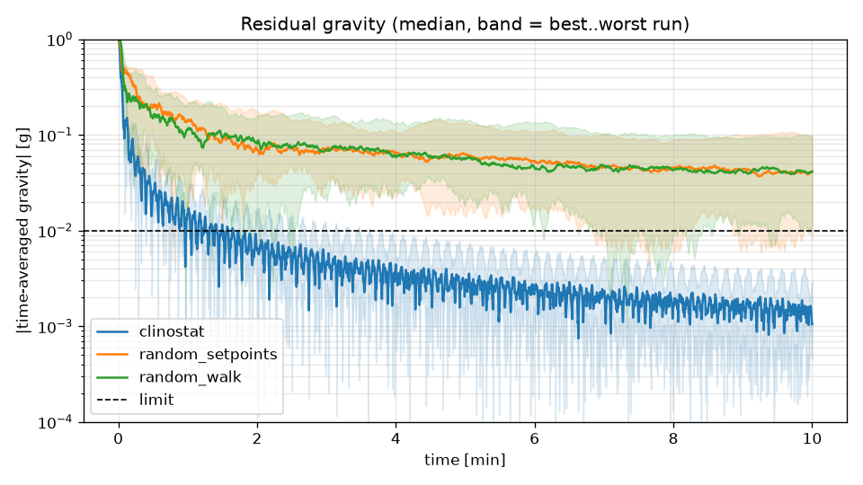
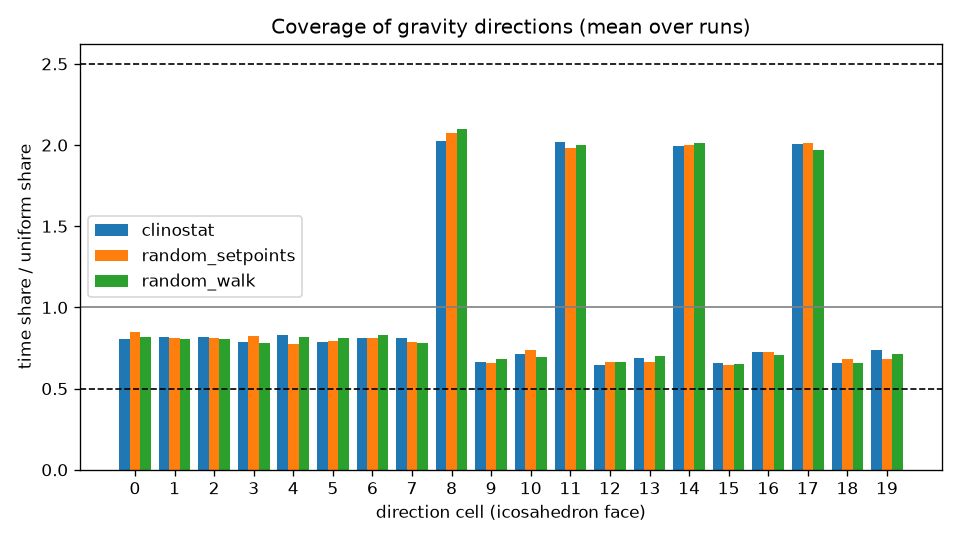

# Strategy comparison

Generated by `rpm-sim compare`: 10 min simulated per run, 25 runs per strategy (nominal servo model plus the four corners of the error envelope: +-20 % speed, +-15 us dead-band shift, 3 % noise, several seeds).

Criteria (docs/api.md): residual gravity < 0.01 g in *every* run, coverage ratio of every cell within [0.5, 2.5].

| Strategy | median residual [g] | worst residual [g] | coverage min..max | pass |
|---|---:|---:|---|:---:|
| `clinostat` | 0.0011 | 0.0030 | 0.60..2.10 | yes |
| `random_setpoints` | 0.0411 | 0.0941 | 0.44..2.33 | no |
| `random_walk` | 0.0415 | 0.0984 | 0.41..2.40 | no |

